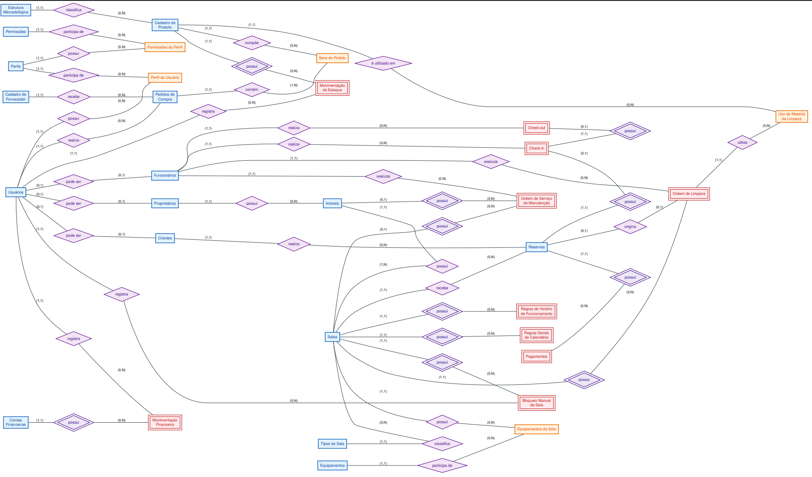
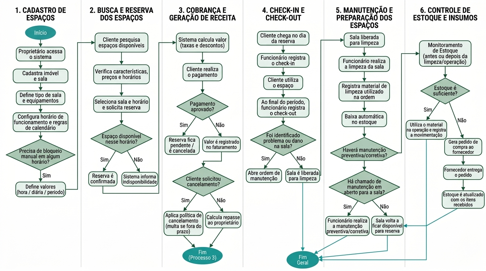

# SpaceAdmin — Sistema de Agendamento e Gestão de Salas

Projeto acadêmico de modelagem e implementação de banco de dados para um sistema de gestão de salas, com foco na organização de informações, no controle de agendamentos e no apoio à tomada de decisões.

## 📌 Sobre o projeto

O **SpaceAdmin** é um projeto de sistema de gestão voltado à organização de salas e seus agendamentos. A proposta é estruturar os dados necessários para representar as operações do negócio, estabelecer relacionamentos entre as informações e aplicar regras que contribuam para a consistência e a integridade dos dados.

O projeto contempla atividades de análise de requisitos, modelagem de dados, elaboração de diagramas, estruturação do modelo relacional, criação de scripts SQL e utilização de dados fictícios para testes.

Além da implementação do banco de dados, o trabalho considera como as informações armazenadas podem futuramente apoiar indicadores operacionais, análises gerenciais, estratégias de marketing, Business Intelligence (BI) e aplicações de Inteligência Artificial (IA).

## 🎯 Objetivos

- Representar os processos do negócio por meio de requisitos e regras de negócio.
- Desenvolver e documentar o modelo conceitual e o modelo lógico relacional.
- Definir tabelas, atributos, chaves primárias e estrangeiras e restrições de integridade.
- Aplicar os princípios de normalização para reduzir redundâncias e inconsistências.
- Criar scripts SQL para estruturar o banco, inserir dados e executar consultas.
- Testar relacionamentos e regras utilizando dados fictícios.
- Demonstrar como os dados podem apoiar análises operacionais e gerenciais.
- Documentar a evolução do projeto em um repositório GitHub.

## 🧩 Escopo do projeto

O desenvolvimento está organizado em duas etapas principais.

### Entrega 1 — Análise e modelagem conceitual

A primeira etapa é voltada ao entendimento do negócio e à identificação das necessidades que o sistema deverá atender.

Entre os elementos previstos nessa etapa estão:

- Caracterização da empresa e justificativa da escolha do negócio.
- Identificação dos processos de negócio.
- Levantamento dos problemas e das necessidades.
- Definição dos requisitos funcionais e não funcionais.
- Identificação das regras de negócio, restrições e políticas organizacionais.
- Elaboração de fluxogramas.
- Identificação de entidades, atributos e relacionamentos.
- Construção do Diagrama Entidade-Relacionamento (DER).
- Justificativas para as decisões de modelagem.

### Entrega 2 — Modelagem relacional e implementação SQL

A segunda etapa dá continuidade à primeira, aprofundando a estrutura dos dados e preparando sua implementação em um banco de dados relacional.

Os principais tópicos são:

- Revisão e evolução da modelagem anterior.
- Conversão do modelo conceitual para o modelo lógico relacional.
- Definição de tabelas, atributos, chaves e relacionamentos.
- Aplicação das formas normais.
- Atualização do dicionário de dados.
- Criação das estruturas por meio de scripts SQL.
- Inserção de dados fictícios.
- Testes de regras válidas e inválidas.
- Consultas para recuperação e análise de informações.
- Identificação de possibilidades de evolução analítica.

## 🗂️ Estrutura do repositório

O repositório está organizado para separar os documentos acadêmicos, os diagramas e os scripts SQL.

```text
erp-agendamento-salas-spaceadmin/
│   .gitignore
│   README.md
│
├───docs
│   ├───diagramas
│   │       DER entrega 1.png
│   │       DER_sistema_reservas.pdf
│   │       DER_sistema_reservas.png
│   │       fluxogramas.jpg
│   │
│   ├───entregas
│   │       Entrega 1 SpaceAdmin.docx
│   │       Entrega 1 SpaceAdmin_CORRIGIDA.docx
│   │       Entrega 2 SpaceAdmin.docx
│   │       Grupo_03.docx
│   │       Grupo_03.pdf
│   │       SpaceAdmin - Completa.docx
│   │
│   ├───modelo logico
│   │       modelo logico.xlsx
│   │
│   └───ppt
│           SpaceAdmin ERP.pptx
│           SpaceAdmin.pdf
│           SpaceAdmin.pptx
│
└───sql
        01_criar_banco.sql
        02_dados_ficticios.sql
        03_testes_regras_invalidas.sql
        04_consultas.sql
```

## 📐 Diagramas

Os diagramas documentam visualmente a estrutura dos dados e os processos considerados no projeto.

### Diagrama Entidade-Relacionamento (DER)

O DER representa as entidades identificadas na análise do negócio, seus atributos e os relacionamentos entre elas.



[Visualizar o arquivo DER](docs/diagramas/DER.png)

### Fluxogramas

Os fluxogramas auxiliam na compreensão dos processos de negócio e na identificação das etapas e regras envolvidas nas operações do sistema.



[Visualizar os fluxogramas](docs/diagramas/fluxogramas.jpg)

## 🗄️ Banco de dados e modelagem relacional

A modelagem relacional tem como objetivo transformar a representação conceitual do negócio em uma estrutura adequada para implementação em um Sistema Gerenciador de Banco de Dados (SGBD).

Essa estrutura deve documentar:

- **Tabelas:** representação das entidades e dos dados armazenados.
- **Atributos:** características representadas em cada tabela.
- **Chaves primárias (PK):** identificação dos registros.
- **Chaves estrangeiras (FK):** representação dos relacionamentos entre tabelas.
- **Chaves compostas:** utilização quando a identificação depender da combinação de atributos.
- **Restrições:** regras que limitam os valores e as operações permitidas.
- **Integridade referencial:** garantia de consistência nos relacionamentos entre registros.

A definição final de tabelas, campos e restrições deve ser consultada nos documentos da Entrega 2 e nos scripts SQL do projeto.

## 🔄 Normalização

A normalização organiza os dados em estruturas relacionais para reduzir redundâncias e evitar anomalias de inserção, atualização e exclusão.

A análise de normalização considera as seguintes formas normais:

| Forma normal | Objetivo |
|---|---|
| **1FN — Primeira Forma Normal** | Organizar os atributos para que cada campo represente um valor atômico, sem grupos repetitivos. |
| **2FN — Segunda Forma Normal** | Eliminar dependências parciais de atributos não-chave em relação a partes de uma chave composta, quando aplicável. |
| **3FN — Terceira Forma Normal** | Eliminar dependências transitivas inadequadas entre atributos não-chave, conforme as dependências funcionais identificadas. |

As justificativas para a decomposição de tabelas e as dependências funcionais relevantes devem ser documentadas conforme a estrutura efetivamente desenvolvida na modelagem.

## 📖 Dicionário de dados

O dicionário de dados documenta a estrutura do banco e deve corresponder à implementação SQL.

Para cada tabela e atributo, recomenda-se registrar:

- Nome da tabela e do atributo.
- Descrição e finalidade.
- Tipo de dado e tamanho, quando aplicável.
- Indicação de chave primária ou estrangeira.
- Obrigatoriedade do preenchimento.
- Restrições e valores permitidos.
- Relacionamentos e regras de integridade.

**Importante:** o dicionário de dados atualizado deve ser mantido alinhado ao modelo lógico e aos scripts SQL. Caso esteja incorporado aos documentos das entregas, sua localização deve ser indicada na documentação correspondente.

## 💻 Scripts SQL

A pasta [`sql/`](sql/) reúne os scripts utilizados para estruturar o banco e realizar testes.

### 1. Criação do banco de dados

Arquivo: [`01_criar_banco.sql`](sql/01_criar_banco.sql)

Responsável pela definição inicial do banco de dados e de suas estruturas, conforme os comandos presentes no arquivo.

### 2. Inserção de dados fictícios

Arquivo: [`02_dados_ficticios.sql`](sql/02_dados_ficticios.sql)

Contém dados de exemplo para apoiar a execução das consultas e a validação dos relacionamentos e das regras implementadas.

Os dados fictícios permitem testar o comportamento do banco sem depender de informações reais de clientes ou operações.

### 3. Testes de regras inválidas

Arquivo: [`03_testes_regras_invalidas.sql`](sql/03_testes_regras_invalidas.sql)

Destinado a verificar situações que devem ser rejeitadas pelas regras e restrições do banco, de acordo com os testes definidos no script.

Os testes podem apoiar a validação de restrições de integridade, relacionamentos e operações incompatíveis com as regras estabelecidas.

## ▶️ Como executar os scripts

1. Clone ou baixe este repositório.
2. Abra o cliente de banco de dados compatível com o dialeto SQL utilizado nos arquivos.
3. Execute o script `01_criar_banco.sql`.
4. Execute `02_dados_ficticios.sql` após a criação das estruturas necessárias.
5. Execute `03_testes_regras_invalidas.sql` para verificar os cenários de teste.
6. Confira os resultados e as mensagens retornadas pelo SGBD.

**Ordem recomendada:**

```text
01_criar_banco.sql
        ↓
02_dados_ficticios.sql
        ↓
03_testes_regras_invalidas.sql
```

Antes da execução, verifique o SGBD esperado, o banco selecionado e a compatibilidade dos comandos SQL. Os testes de regras inválidas podem gerar erros intencionais; nesses casos, é necessário verificar se o comportamento observado corresponde ao esperado.

## 📊 Análise de dados e informações gerenciais

Os dados estruturados do SpaceAdmin podem servir de base para indicadores e relatórios que auxiliem no acompanhamento das operações e na tomada de decisões.

### Indicadores operacionais

Consultas SQL podem ser utilizadas para produzir indicadores, conforme as informações disponíveis no modelo implementado.

Exemplos de análises possíveis:

- Quantidade de agendamentos por período.
- Distribuição dos agendamentos por sala.
- Identificação de horários com maior procura.
- Frequência de utilização das salas.
- Comparação entre períodos.
- Identificação de registros cancelados ou alterados, caso essas informações sejam armazenadas.

Esses indicadores podem ajudar a compreender a demanda, identificar períodos de maior utilização e apoiar o planejamento da capacidade.

### Informações gerenciais

A consolidação dos dados pode auxiliar a gestão a responder perguntas como:

- Quais períodos apresentam maior demanda por salas?
- Quais salas são mais utilizadas?
- Existem horários com baixa utilização?
- Como a procura varia ao longo do tempo?
- Quais informações devem ser consideradas no planejamento da disponibilidade?

As respostas dependem dos dados existentes, das regras de negócio e das consultas implementadas.

### Perfil dos clientes e marketing

Caso o modelo armazene informações adequadas sobre clientes e seu histórico de utilização, os dados poderão apoiar análises de perfil e estratégias de marketing.

Possibilidades futuras incluem:

- **Segmentação de clientes:** agrupar clientes por padrões de utilização ou frequência de agendamento.
- **Análise de recorrência:** identificar clientes que utilizam o serviço repetidamente.
- **Preferências de utilização:** analisar os tipos de sala e os períodos mais procurados, quando essas informações estiverem disponíveis.
- **Campanhas direcionadas:** desenvolver ações de comunicação adequadas a diferentes segmentos.
- **Retenção de clientes:** acompanhar indicadores de retorno e identificar oportunidades de melhorar a experiência.
- **Análise de demanda:** utilizar padrões históricos para apoiar decisões comerciais e operacionais.

Essas análises devem respeitar a finalidade da coleta, a segurança dos dados e a legislação aplicável, incluindo a Lei Geral de Proteção de Dados Pessoais (LGPD).

As possibilidades de marketing descritas nesta seção não significam que exista uma ferramenta de marketing implementada no projeto. Elas representam oportunidades de utilização futura dos dados, condicionadas às informações efetivamente armazenadas.

## 📈 Business Intelligence (BI)

O Business Intelligence reúne processos e ferramentas para transformar dados operacionais em informações úteis à gestão.

Como evolução do SpaceAdmin, seria possível utilizar ferramentas de BI para construir painéis com indicadores como:

- Agendamentos por dia, semana ou mês.
- Utilização das salas por período.
- Distribuição da demanda entre salas.
- Evolução histórica da procura.
- Indicadores de recorrência dos clientes, caso haja dados suficientes.
- Comparação entre períodos e identificação de tendências.

Uma evolução possível seria integrar o banco a uma ferramenta de visualização de dados, criando dashboards que facilitem o acompanhamento dos indicadores.

Essa integração dependeria da preparação das consultas, da definição dos indicadores e da validação da qualidade dos dados.

## 🤖 Possibilidades futuras de Inteligência Artificial

A IA poderá ser considerada em etapas futuras, quando houver dados suficientes, consistentes e adequados para a finalidade pretendida.

Algumas possibilidades são:

- **Previsão de demanda:** estimar os períodos com maior procura por salas a partir do histórico de agendamentos.
- **Recomendações:** sugerir salas ou horários com base em critérios de disponibilidade e padrões de utilização.
- **Identificação de padrões:** detectar tendências de comportamento na utilização dos serviços.
- **Apoio ao planejamento:** auxiliar na análise da ocupação e na distribuição da demanda.
- **Análise de comportamento de clientes:** identificar padrões agregados que possam contribuir para melhorar os serviços.

Essas aplicações são propostas de evolução, e não funcionalidades que se possa afirmar como já implementadas. Sua viabilidade dependerá da qualidade, do volume e da adequação dos dados, além da avaliação de privacidade, segurança e possíveis vieses.

## 🔐 Integridade e qualidade dos dados

A consistência dos dados é essencial para que as consultas e análises produzam resultados confiáveis.

A modelagem e os testes devem considerar:

- Validade dos relacionamentos entre tabelas.
- Respeito às chaves primárias e estrangeiras.
- Cumprimento das restrições definidas.
- Prevenção de registros incompatíveis com as regras de negócio.
- Consistência dos dados inseridos e atualizados.
- Testes de operações permitidas e não permitidas.

Os scripts de teste ajudam a verificar o comportamento do banco, enquanto a documentação permite relacionar as regras de negócio às restrições implementadas.

## 📚 Documentação do projeto

Os materiais acadêmicos e de apresentação estão disponíveis na pasta [`docs/`](docs/).

### Entregas acadêmicas

- [Entrega 1 — SpaceAdmin](docs/entregas/Entrega%201%20SpaceAdmin.docx)
- [Entrega 1 — SpaceAdmin corrigida](docs/entregas/Entrega%201%20SpaceAdmin_CORRIGIDA.docx)
- [Entrega 2 — SpaceAdmin](docs/entregas/Entrega%202%20SpaceAdmin.docx)
- [SpaceAdmin — documentação completa](docs/entregas/SpaceAdmin%20-%20Completa.docx)

### Apresentação corporativa

- [Apresentação em PDF](docs/ppt%20corporativo/SpaceAdmin.pdf)
- [Arquivo PowerPoint](docs/ppt%20corporativo/SpaceAdmin.pptx)

Os documentos permitem acompanhar a análise inicial, a evolução da modelagem e a apresentação geral da proposta.

## 🛠️ Tecnologias e recursos

Os recursos identificados na estrutura do repositório incluem:

- **SQL:** definição e manipulação de dados por meio de scripts.
- **SGBD relacional:** ambiente necessário para executar e testar os scripts SQL.
- **Git e GitHub:** versionamento e organização dos arquivos.
- **Diagramas:** representação visual do modelo de dados e dos processos.
- **Documentação acadêmica:** registro dos requisitos, decisões de modelagem e resultados do projeto.

O SGBD e as ferramentas específicas utilizadas devem ser confirmados nos scripts e na documentação técnica da equipe.

## 🚀 Possibilidades de evolução

Como próximos passos, o projeto poderá evoluir com:

1. Revisão final da consistência entre requisitos, regras de negócio, DER e modelo relacional.
2. Atualização do dicionário de dados para refletir todas as estruturas implementadas.
3. Ampliação dos testes de integridade e dos cenários de negócio.
4. Desenvolvimento de consultas gerenciais documentadas.
5. Organização de indicadores operacionais e comerciais.
6. Criação de dashboards em uma ferramenta de BI.
7. Avaliação de análises de perfil de clientes e oportunidades de marketing.
8. Estudo de aplicações de IA, condicionado à disponibilidade e à qualidade dos dados.

## 👥 Organização e versionamento

O projeto está organizado em um repositório GitHub para centralizar os documentos, diagramas e scripts SQL.

O histórico de commits pode ser utilizado para acompanhar as alterações realizadas durante o desenvolvimento. Para facilitar a avaliação e a manutenção, recomenda-se utilizar mensagens de commit que descrevam as mudanças, por exemplo:

- `docs: atualizar documentação da entrega`
- `docs: revisar diagrama entidade-relacionamento`
- `sql: ajustar estrutura do banco`
- `sql: adicionar dados fictícios`
- `test: incluir validações de regras de negócio`

Esses exemplos são sugestões de padronização, não um registro dos commits já realizados.

## 📌 Considerações finais

O SpaceAdmin reúne atividades de análise de negócio, modelagem de dados, documentação e implementação SQL em um projeto acadêmico de gestão e agendamento de salas.

A estrutura do repositório facilita o acesso aos materiais e aos scripts, enquanto a modelagem relacional e os testes fornecem uma base para validar a organização e a integridade dos dados.

A partir dessa base, as informações armazenadas poderão apoiar consultas operacionais, análises gerenciais, estudos de perfil de clientes, iniciativas de BI e, futuramente, aplicações de Inteligência Artificial.

**Repositório:** [erp-agendamento-salas-spaceadmin](https://github.com/Pablo-Liraa/erp-agendamento-salas-spaceadmin)
## 🌐 Desenvolvimento Front-end do SpaceAdmin ERP


O projeto SpaceAdmin ERP também possui uma frente de desenvolvimento web, realizada em paralelo à modelagem do banco de dados. O objetivo é construir a interface visual do sistema de gestão e reservas de espaços, aproximando a estrutura de dados da experiência de utilização do usuário.

O desenvolvimento front-end utiliza **HTML5 e CSS3**, com páginas organizadas para representar diferentes módulos do sistema, como reservas, agenda, clientes, imóveis, funcionários, estoque e financeiro.

### Tecnologias e estrutura

- **HTML5:** estruturação das páginas, formulários, campos de entrada, tabelas, menus e demais componentes da interface.
- **CSS3:** estilização das páginas, organização visual, tipografia, cores, espaçamentos e adaptação da interface.
- **JavaScript:** presente na estrutura do projeto para scripts e comportamentos da interface, conforme os arquivos existentes no repositório front-end.

### Etapa atual

O front-end está em desenvolvimento, com foco na revisão e finalização das páginas, no uso adequado das tags e atributos HTML, na organização dos estilos CSS e no aprimoramento da navegação e da consistência visual.

### Relação entre o front-end e o banco de dados

O front-end representa a camada de interação do sistema, enquanto o banco de dados organiza e mantém as informações necessárias às operações.

Em uma evolução integrada, a aplicação poderá utilizar uma camada de back-end para conectar as interfaces ao banco de dados, processando operações como consultas, cadastros, alterações e gerenciamento de reservas.

**Repositório do front-end:** [github.com/Slyyd/spaceadmin-erp](https://github.com/Slyyd/spaceadmin-erp)

O desenvolvimento da interface complementa o projeto de modelagem de dados e contribui para a evolução do SpaceAdmin ERP como uma solução integrada de gestão de espaços e reservas.
